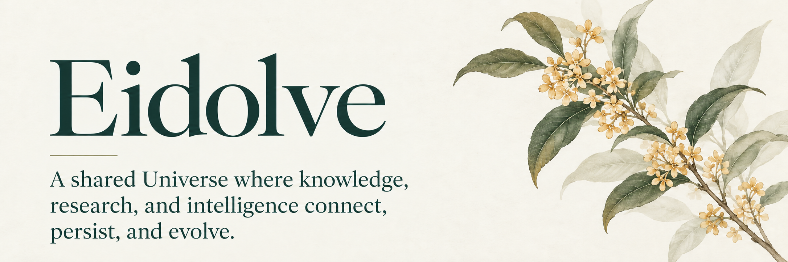

  

[Universe](docs/UNIVERSE.md) · [Foundations](docs/FOUNDATIONS.md) · [Architecture](docs/ARCHITECTURE.md) · [Research agenda](docs/RESEARCH.md) · [Evaluation and evolution](docs/EVALUATION_AND_EVOLUTION.md) · [Research and engineering standard](docs/RESEARCH_AND_ENGINEERING_STANDARD.md)

Eidolve is an independent open-source project to build a universal, connected, searchable, and evolving world for AI, LLMs, agents, humans, and research systems.

Its core concept is **Universe**: a shared and persistent world in which information, files, data, code, papers, experiments, evidence, knowledge, memory, research processes, models, agents, people, tools, systems, environments, histories, and relationships can be preserved, connected, searched, understood, used, revised, and extended across systems, servers, versions, users, projects, and sessions.

Eidolve is not reducible to a database, file system, knowledge graph, wiki, search engine, memory system, agent framework, model-training platform, data pipeline, evaluation system, or research workflow. Each may become part of the Universe, but none defines it alone.

## The idea

Modern intelligence is fragmented. Knowledge is separated from files; files from research; research from memory; memory from models; models from tools and environments; and every system, server, project, user, version, and session creates another boundary.

Eidolve treats these not as isolated stores and applications, but as parts of one continuously developing Universe. The purpose is to make accumulated information, knowledge, experience, research, and capability remain available and meaningful beyond the lifetime of any single model, agent, application, machine, project, or conversation.

The Universe must serve:

- research and scientific discovery;
- reasoning, cognition, judgment, and decision-making;
- information, knowledge, files, data, and memory;
- AI models, LLMs, agents, humans, and their collaboration;
- training, evaluation, learning, and capability evolution;
- continuity across systems, servers, versions, users, projects, and sessions.

## Foundations

Eidolve draws on several foundational ideas without collapsing into any one of them:

- **Git** — history, evolution, branching, merging, provenance, and distributed contribution;
- **knowledge graphs** — explicit entities, relations, structures, dependencies, and connections;
- **Wiki and Wikipedia** — cumulative synthesis, shared understanding, revision, and navigable knowledge;
- **Google-style search** — discovery, indexing, relevance, ranking, and access at scale;
- **files and native artifacts** — preservation of documents, code, data, media, experiments, models, and every other original form of information.

These foundations must work as one system. Search must understand relations and history. Wiki synthesis must remain connected to evidence and artifacts. Graphs must connect rather than replace files. Git must preserve evolution without forcing every kind of data into one repository. AI and humans must be able to read from, reason over, act through, and contribute back to the same Universe.

## Continuous evaluation and evolution

The scientific and engineering frontier continuously produces new knowledge, observations, tools, workflows, requirements, solved problems, and failures. Eidolve can turn this changing world into a continuing supply of high-quality examinations by filtering noise, recovering the original task, preserving the required environment, defining observable success, and recording provenance and exposure.

This supports separate evaluation of models, harnesses, and complete model–harness systems. A minimal implementation uses one examiner system to build and maintain tasks and environments, one stable blue system, and one candidate green system. Blue and green are compared under matched conditions; promotion depends on real capability, reliability, cost, regression control, and fresh tasks rather than one benchmark score. This is one function of Universe, not its boundary.

## Core principles

1. **One Universe, not isolated silos.** Information, knowledge, artifacts, memory, research, systems, and intelligence must remain connected.
2. **Identity survives location.** Moving a file, project, model, server, or system must not destroy its meaning or relationships.
3. **Original artifacts remain first-class.** Structured knowledge complements files and data; it does not erase or flatten them.
4. **History is part of knowledge.** The Universe preserves how information, claims, research, decisions, and systems change.
5. **Search is a primary interface to the whole.** Discovery must operate across files, data, relations, knowledge, history, and research.
6. **Knowledge is living.** It can be revised, connected, synthesized, challenged, and extended.
7. **Humans and machine intelligence are both native participants.** The system is neither merely human documentation nor merely an AI memory layer.
8. **No model, vendor, application, or infrastructure defines the Universe.** All are participants and integrations.
9. **Research is not an attachment.** Questions, hypotheses, methods, experiments, evidence, failures, results, and decisions belong inside the same world.
10. **The Universe must improve through use.** Retrieval, reasoning, research, feedback, evaluation, and new evidence should deepen the shared world rather than disappear into temporary context.
11. **Metrics remain subordinate to purpose.** Benchmarks, tests, verifiers, and reward signals matter only while they continue to measure the intended capability and predict real work.
12. **Activity is not progress.** A contribution should improve understanding, methods, capability, reliability, transfer, or outcomes rather than merely add structure or volume.

## Name

**Eidolve** connects *eidos*—form, structure, and essence—with *evolve*. The name expresses intelligence evolving through deeper understanding. The project, however, is broader than self-evolution or any single AI method: its central undertaking is the construction of the Universe in which knowledge, research, and intelligence can persist and develop.

## Independence

Eidolve is an independent project. Qiushi Engine may integrate with it, use it, and contribute to it, as may other research systems, agents, models, tools, and people. No single integration owns or bounds the Universe.

## Documents

- [Universe](docs/UNIVERSE.md)
- [Foundations](docs/FOUNDATIONS.md)
- [Architecture](docs/ARCHITECTURE.md)
- [Research agenda](docs/RESEARCH.md)
- [Continuous evaluation and evolution](docs/EVALUATION_AND_EVOLUTION.md)
- [Research and engineering standard](docs/RESEARCH_AND_ENGINEERING_STANDARD.md)

## Status

Eidolve is at its foundation stage. The first objective is to establish a coherent concept, architecture, and research program before narrowing the project into a particular product or technology stack.